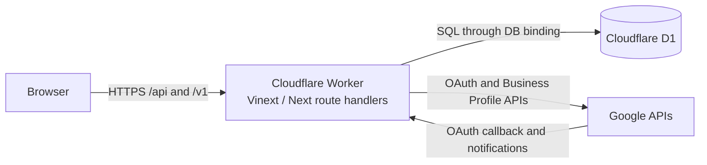

# ReviewRadar

ReviewRadar is a bilingual reputation-intelligence SaaS prototype. A business owner connects Google Business Profile, selects locations, imports reviews, and uses the dashboard to understand ratings, sentiment, topics, and operational issues.

The beta runtime is intentionally simple: **the browser talks to one Cloudflare Worker, and the Worker stores application data in Cloudflare D1 and calls Google APIs server-side**. See [ADR-001](docs/adr/001-runtime.md) for the decision and its review triggers.

## Runtime flow



The browser never receives Google client secrets, OAuth refresh tokens, the token-encryption key, or the D1 binding.

## Stack

- TypeScript, React 19, Next.js 16 route conventions
- Vinext and Vite
- Cloudflare Workers and D1
- OpenAI Sites Vite integration
- Zod for strict schemas in domain boundaries
- Google Business Profile OAuth and review APIs

## Requirements

- Node.js `>=22.13.0` (Node 22 LTS or newer)
- npm (the committed `package-lock.json` is authoritative)
- PowerShell for the current local development script
- Google OAuth credentials only when testing the Google integration

Outside Codex, check the system Node before installing:

```powershell
node --version
```

Inside Codex, `npm run dev` prefers Codex's bundled Node runtime. The system `node --version` may therefore show an older version even though the development script uses a supported bundled version; the script prints a clear error only when neither supported runtime is available.

## First local run

```powershell
git clone https://github.com/Vova445/reviewRadar.git
Set-Location reviewRadar
npm ci
Copy-Item .env.example .env.local
npm run dev
```

Open <http://localhost:4000>. The local development database is provided by the Cloudflare D1/Miniflare binding declared as `DB` in `.openai/hosting.json`.

For a basic launch and UI review, the copied placeholders may remain blank. Populate the Google and encryption variables only before testing Google connection/synchronization. Production must never use blank security values.

The development command uses the bundled Codex Node runtime when available. Outside Codex it uses the system Node installation and stops with a clear error if the version is too old.

## Environment variables

Never commit `.env.local`, production secrets, OAuth tokens, or key material. `.env.example` contains names and safe placeholders only.

### Core authentication

| Name | Required | Purpose |
|---|---:|---|
| `AUTH_PASSWORD_PEPPER` | Production | Additional server-side input for password derivation. Use a long random secret. |

### Google Business Profile

| Name | Required | Purpose |
|---|---:|---|
| `GOOGLE_CLIENT_ID` | Google integration | OAuth client ID. |
| `GOOGLE_CLIENT_SECRET` | Google integration | OAuth client secret. |
| `GOOGLE_REDIRECT_URI` | Google integration | Exact OAuth callback URI. Local default: `http://localhost:4000/v1/integrations/google/callback`. |
| `OAUTH_TOKEN_ENCRYPTION_KEY` | Google integration | Secret used to encrypt provider tokens at rest. |
| `OAUTH_TOKEN_ENCRYPTION_KEY_ID` | Recommended | Identifier stored with encrypted tokens for future key rotation. |
| `GOOGLE_PUBSUB_VERIFICATION_TOKEN` | Notifications | Verification value for the current Google notification endpoint. |
| `GOOGLE_SYNC_SECRET` | Scheduled/manual sync | Bearer secret for `/v1/jobs/google/sync`. |

### Optional or future modules

| Name | Purpose |
|---|---|
| `OPENAI_API_KEY` | Future runtime AI-analysis adapter. |
| `TELEGRAM_BOT_TOKEN` | Future Telegram alert adapter. |
| `YELP_API_KEY` | Future provider research/integration. |
| `TRIPADVISOR_API_KEY` | Future provider research/integration. |
| `META_APP_ID`, `META_APP_SECRET` | Future Meta integration. |
| `BOOKING_CONNECTIVITY_CLIENT_ID`, `BOOKING_CONNECTIVITY_CLIENT_SECRET` | Future Booking.com integration. |

The D1 database is not configured through an environment URL. Cloudflare injects it through the `DB` binding.

## Google redirect URIs

Add these exact values to the Google OAuth client. Protocol, host, port, path, and trailing slash must match exactly.

- Local: `http://localhost:4000/v1/integrations/google/callback`
- Production Worker: `https://reviewradar.reviewradar-vova445.workers.dev/v1/integrations/google/callback`

Set `GOOGLE_REDIRECT_URI` to the matching value in each environment.

## Commands

| Command | Description |
|---|---|
| `npm ci` | Install the exact locked dependency graph. |
| `npm run dev` | Start the local Worker-compatible server on port 4000. |
| `npm run dev:win` | Windows fallback that validates/selects Node and clears the Vite cache. |
| `npm run build` | Create a production build. |
| `npm run start` | Start the built application. |
| `npm run lint` | Run ESLint and fail on errors or warnings. |
| `npm run typecheck` | Run strict TypeScript checking without emitting files. |
| `npm test` | Run the Vitest suite once. |

## Useful routes

- `/` — product entry page
- `/auth` — registration and login
- `/dashboard` — authenticated workspace dashboard
- `/v1/integrations/google/connect` — begin Google OAuth
- `/v1/integrations/google/callback` — Google OAuth callback
- `/v1/integrations/google/locations` — list/select discovered locations
- `/v1/jobs/google/sync` — protected synchronization endpoint

## Troubleshooting

### Node reports `styleText` or the build runs on Node 20

Install Node 22 LTS or newer, close the terminal, confirm `node --version`, then run `npm ci` again.

### Windows reports a missing `@rolldown/binding-win32-x64-msvc`

Pull the latest `package.json` and `package-lock.json`, which declare the Windows native binding explicitly, then rerun `npm ci`. Do not delete or regenerate the committed lockfile.

### `D1 binding DB is not configured`

Start the project through `npm run dev`, not by invoking the framework entry file directly. Confirm `.openai/hosting.json` contains `"d1": "DB"`.

### Google returns `redirect_uri_mismatch`

Compare `GOOGLE_REDIRECT_URI` with the Google Console value character by character. Do not add a trailing slash.

### Google connect reports a missing variable

Populate the required Google and encryption variables in `.env.local`, restart the server, and begin OAuth again. Never paste secret values into issues or logs.

### Port 4000 is already in use

Stop the previous ReviewRadar development process and rerun `npm run dev`. Changing the port also requires changing the registered Google callback.

## Architecture and project status

- [ADR-001: Workers + D1 through beta](docs/adr/001-runtime.md)
- [Current architecture](docs/production-architecture.md)
- [Execution roadmap](docs/execution-roadmap.md)
- [Google integration notes](docs/google-business-profile.md)
- [Security baseline](docs/operations-security.md)

The repository is a working prototype, not yet a production-ready paid SaaS. Before external customer data is accepted, complete the P0 security, asynchronous-job, testing, observability, and retention work in the execution roadmap.
