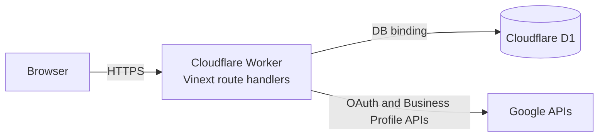

# ADR-001: Cloudflare Workers and D1 through beta

- Status: Accepted
- Date: 2026-10-30
- Owners: ReviewRadar engineering
- Supersedes: the separate-backend runtime described by the previous architecture document

## Context

The executable repository already runs authenticated routes, Google OAuth, review synchronization, and dashboard queries inside Vinext on Cloudflare Workers. Those routes use the Cloudflare `DB` binding and the D1 schema in `db/schema.ts`.

Previous documentation described a separate backend and a different database/queue stack. That did not match the application, created competing schemas, and made setup and deployment ambiguous. Beta needs one runtime that a small team can operate while validating Google access and the Reputation Autopsy product loop.

## Decision

Through beta, ReviewRadar uses one Cloudflare-native runtime:

- Route handlers own authentication, workspace authorization, validation, and D1 transactions.
- D1 is the authoritative beta datastore.
- Google secrets and OAuth tokens remain server-side; tokens are encrypted before persistence.
- Background work will use Cloudflare-native queues and scheduled triggers when P0 asynchronous processing is implemented.
- `db/schema.ts` and ordered D1 migrations are the authoritative beta schema path.
- Files under `db/postgres/` are non-runtime research artifacts and are not beta deployment inputs.

## Consequences

### Positive

- Local and hosted runtime use the same Worker/D1 model.
- There is one database binding, one active schema, and one deployment boundary.
- No separately operated backend is required for beta.
- Cloudflare-native queues and cron can be added without changing the browser/API boundary.

### Trade-offs

- Synchronous Google synchronization must move into durable Cloudflare jobs before production use.
- D1 transaction, throughput, query, and migration constraints must be measured against expected beta volume.
- The research schema under `db/postgres/` may drift and should be archived or removed if no later ADR adopts it.

## Security and operational requirements

- The browser never calls Google APIs or D1 directly.
- Every query is scoped to the authenticated workspace.
- Cookie-authenticated mutations require CSRF/origin protection before external beta.
- Provider tokens remain encrypted at rest and absent from logs.
- Long-running sync, AI, notification, report, and retention work must use durable jobs.
- D1 migrations must become ordered deployment steps rather than request-time DDL.

## Revisit triggers

Re-evaluate this ADR after beta only when measured evidence shows one or more of the following:

1. D1 cannot meet documented latency, transaction, query, storage, or concurrency requirements.
2. Compliance or data-residency requirements cannot be met on the selected Cloudflare setup.
3. Required workloads need capabilities unavailable in the Cloudflare runtime.
4. Enterprise isolation or reporting requires a materially different data model.
5. Operational cost or reliability data demonstrates a better architecture.

Any review must include metrics, migration cost, rollback strategy, and a replacement ADR. Preference alone is not a migration trigger.

## Future, not current runtime

A separate service with PostgreSQL and a Redis-compatible queue may be evaluated after beta under the triggers above. Until a replacement ADR is accepted, it is not part of setup, deployment, environment configuration, or production claims.
