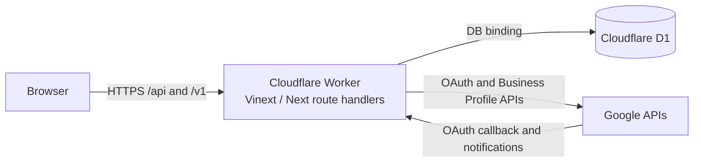

# ReviewRadar runtime architecture

ADR-001 defines the current architecture: **Cloudflare Workers + D1 through beta**.

## Runtime boundary

The browser never calls D1, the AI provider, or Google Business Profile directly. Worker route handlers authenticate the user, resolve workspace membership, validate input, execute D1 operations, and call external HTTPS APIs. Provider credentials and encryption keys remain server-side.

The `DB` binding in `.openai/hosting.json`, `db/schema.ts`, and D1 migration files are the authoritative beta persistence path.

## Request and background-work ownership

Request handlers may perform bounded authentication, validation, reads, and transactional writes. Long-running Google synchronization, AI analysis, anomaly detection, notifications, reports, and retention cleanup must move to Cloudflare-native queues/workers or scheduled triggers before external beta.

Target asynchronous flow:

1. A route validates and commits a small state change in D1.
2. It enqueues a job with workspace/resource identifiers and an idempotency key.
3. A worker loads the minimum required data.
4. External responses are validated and committed transactionally.
5. Retries use bounded backoff; exhausted jobs enter a dead-letter workflow.
6. Logs contain identifiers and sanitized errors, never secrets or retained review text.

## Insight cost control

D1 performs deterministic aggregation over structured review topics. Only clusters above support/confidence thresholds are sent to AI for a short explanation and recommended action. The model is not asked to repeatedly analyze the entire review history.

## Secrets

OAuth tokens are encrypted before persistence. Ciphertext and key identifiers may be stored in D1; secret key material belongs in managed Cloudflare secrets. Logs must redact authorization headers, tokens, review text, prompts, and secret values.

## Future architecture options

After beta, ADR-001 may be revisited using measured limits, compliance requirements, cost, and reliability data. A separate HTTPS service with PostgreSQL and a Redis-compatible queue is only a future option; it is not the current runtime, setup requirement, or deployment target. The SQL files under `db/postgres/` are research artifacts until a replacement ADR explicitly adopts them.
